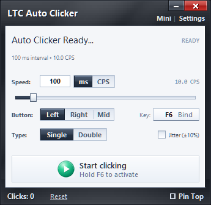
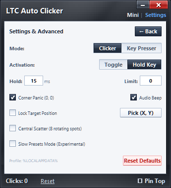
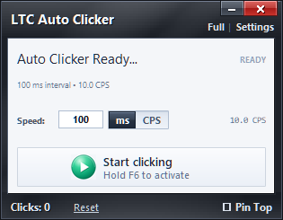

# LTC AutoClicker

A high-performance Windows desktop autoclicker utility built with Python, CustomTkinter, and native Win32 `SendInput` APIs, featuring a modern frameless dark metallic greyscale shell.

## Interface Preview

<p align="center">
  
  &nbsp;&nbsp;
  
</p>

<p align="center">
  <em>Left: Main Controller Interface • Right: Settings & Advanced Safety Controls</em>
</p>

<p align="center">
  
  <br />
  <em>Compact Mini Bar Mode (unobtrusive overlay for multitasking)</em>
</p>

---

## Key Features

- **High-Speed Clicking & Key Presser**: Custom millisecond intervals or Clicks Per Second (CPS) powered by the Win32 `SendInput` API, with hardware scan-code keyboard key repeating (`Space`, `E`, `Backspace`, `Enter`, etc.).
- **Frameless Metallic Shell**: Custom dark metallic bezel with subtle glass gradients, built-in inset caption controls (minimize/close), and full 8-direction edge-drag resizing.
- **Compact Mini Bar Mode**: Minimalist, unobtrusive floating bar for multitasking and gaming overlay.
- **Button & Click Types**: Left, right, or middle mouse buttons; single or double clicking.
- **Global Hotkey & Safety Controls**:
  - Global hotkey listener (default **F6**, supports keyboard keys + `Mouse 4` / `Mouse 5` / `Mid Click`) with in-app key rebinding. `Mid Click` can't be the hotkey while the clicker uses the middle button, since its own clicks would trigger it.
  - Emergency failsafes: dedicated **Pause** break key, top-left screen corner panic stop, and automatic **Self-Click Protection** (clicking pauses while the cursor is over the app window; key pressing pauses while the app window has focus).
  - The corner panic stop watches the main screen's `(0, 0)` corner. With **Lock Target Position** or **Central Scatter** at fast speeds the cursor is moved back on every click, so use the **Pause** key instead.
  - Dual trigger modes: **Toggle** (start/stop) or **Hold Key** (active only while held).
- **Target Position Locking**: Lock clicks to a fixed `(X, Y)` coordinate with interactive on-screen `Pick (X, Y)` target selection.
- **Central Cursor Scatter**: 8-spot rotating cursor scatter around screen center.
- **Slow AFK Presets**: Dedicated modes with 5-minute (Very Slow), 1-minute (Slow), and 100ms (Fast) presets.
- **Live Session Statistics**: Real-time click/key counter and active timer in bezel footer with one-click reset.

---

## Quick Start & Installation

### Option 1: Standalone Portable Executable (Recommended)
Download `LTC-AutoClicker.exe` from the [Latest Release](https://github.com/ltchaotic23/LTC-AutoClicker/releases/latest) and run it directly. No installation or Python runtime is required.

### Option 2: Run From Source
Prerequisites: Python 3.12+ on Windows.

```powershell
python -m pip install -r requirements.txt
python main.py
```

### Option 3: Compile Standalone Executable
To compile your own standalone executable using PyInstaller:

```powershell
python -m pip install -r requirements-dev.txt
python build.py
```
The compiled binary will be generated at `dist/LTC-AutoClicker.exe`.

To compile and register the application in `%LOCALAPPDATA%\Programs\LTC-AutoClicker\` with a canonical Windows Start Menu shortcut:
```powershell
python build.py --install
```

---

## Automated Test Suite

The test suite includes 43 comprehensive unit, fuzzing, and stress tests:
```powershell
python -m unittest discover -s tests -v
```

---

## Privacy & Input Transparency

- **No Keylogging**: Hotkey detection uses the native Windows `GetAsyncKeyState` API **strictly** to query the physical up/down state of the single user-configured hotkey and the emergency `Pause` break key. The application does not monitor general typing, capture passwords, or log typed text.
- **Local-Only Operation**: LTC AutoClicker contains **zero network, telemetry, or analytics transmission code**. No data ever leaves your computer.
- **Local Configuration & Stored Fields**:
  Settings are persisted locally in plaintext JSON at `%LOCALAPPDATA%\AutoClicker-LTC\config.json`. The exact fields and default values stored are strictly limited to your operational preferences:
  - `active_mode`: Active tool mode (default `"clicker"`, or `"key_presser"`).
  - `speed_unit`: Speed input unit (default `"ms"`, or `"cps"`).
  - `click_interval_ms`, `target_cps`: Interval and rate (default `100`, `10.0`).
  - `mouse_button`, `click_type`: Mouse button (`"left"`, `"right"`, `"middle"`) and click type (`"single"`, `"double"`).
  - `hotkey`, `hotkey_vk`: Activation key name and Win32 virtual-key code (default `"F6"`, `0x75`).
  - `target_key`, `target_key_vk`: Repeated key in Key Presser mode (default `"Space"`, `0x20`).
  - `trigger_mode`: Activation behavior (default `"toggle"`, or `"hold"`).
  - `click_limit`: Repeat limit before auto-stopping (default `0` = infinite).
  - `hold_duration_ms`: Key/button down-to-up duration (default `15` ms).
  - `panic_corner`: Emergency stop when cursor touches top-left screen corner (default `true`).
  - `lock_cursor_pos`, `locked_x`, `locked_y`: Screen targeting coordinates (default `false`, `-1`, `-1` = unassigned).
  - `window_x`, `window_y`: Desktop window coordinates for session restoration (default `-1`, `-1` = OS default).
  - Safety & feature flags: `self_click_protection` (`true`), `sound_enabled` (`true`), `jitter` (`false`), `always_on_top` (`false`), `central_scatter` (`false`), `slow_presets` (`false`), `slow_preset_choice` (`"fast"`).
  
  *All local data can be instantly wiped by clicking **Reset Defaults** in the app or deleting the `%LOCALAPPDATA%\AutoClicker-LTC\` folder. The v1.0.0 release and earlier builds could also write crash logs to a `crash_reports\` subfolder there; it is safe to delete.*
- **Zero Disk Diagnostic Logs**:
  LTC AutoClicker writes **zero crash logs, telemetry files, or dumps to disk**. If an unexpected runtime exception ever occurs, it presents an in-memory, transient on-screen Windows alert dialog with sanitized file paths so you can view or screenshot the error without leaving any files on your hard drive.

---

## Disclaimer & Responsible Use

LTC AutoClicker is designed for productivity, accessibility, and software automation testing. Using automated input utilities in certain online multiplayer games or third-party services may violate their Terms of Service (ToS) or trigger automated detection systems. Use responsibly and at your own discretion.
